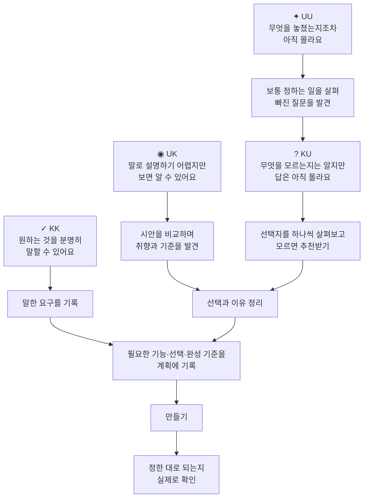

# automix-light (aml)

> 처음 앱을 만드는 사람을 위한 Claude Code · Codex · Copilot CLI 플러그인입니다. automix의 핵심 기능을 간추린 한국어 버전으로, 기획부터 구현, 검증, 사용 후 개선까지 안내합니다.

설치를 마쳤다면 **[초보자용 그림 안내서](manual/automix-light-manual.html)**로 시작하세요. `new`로 계획하고 `go`로 만드는 흐름과 KK·UK·KU·UU를 같은 예시로 설명합니다. `manual/automix-light-manual.html` 파일을 브라우저에서 열면 됩니다. GitHub에서는 파일을 내려받은 뒤 열어 주세요. 본문과 그림, 용어 설명은 인터넷 연결 없이도 작동합니다.

Anthropic의 [AI-Native SDLC 플레이북](https://claude.com/blog/the-ai-native-sdlc-playbook)을 바탕으로, **혼자 앱을 만드는 사람도 따라갈 수 있도록 개발 절차를 간소화했습니다.** 핵심은 각 단계의 결과를 문서로 남기고, 다음 단계에서 그 문서를 기준으로 작업하는 것입니다.

아이디어를 구체화하고, 구현 계획을 세우고, 앱을 만든 뒤 검증합니다. 완성된 앱을 직접 사용하면서 발견한 문제와 필요한 기능은 다음 작업에 반영합니다.

| 단계 | 기록하는 내용 |
|---|---|
| 기획 (`intent.md`) | 앱을 만드는 목적과 해결하려는 문제 |
| 요구사항 정의 (`spec.md`) | 필요한 기능과 완성 기준 |
| 작업 계획 (`task.md`) | 작업 순서, 변경할 파일, 예상 위험, 검증 방법 |
| 구현 및 검증 (코드 + `progress.md`) | 구현 결과, 검증 결과, 소요 시간과 비용 |
| 코드 리뷰 | 버그, 보안 문제, 요구사항 충족 여부 |
| 사용 후 개선 | 작은 수정은 `task.md`에 추가하고, 새 기능이나 방향 변경은 `intent.md`에 정리 |

명령어 정의, 템플릿, 작업 결과는 모두 마크다운 파일로 관리합니다. 실행 코드는 작업 지표 기록 스크립트(`observe.py`, 파이썬 표준 라이브러리만 사용)와 Claude Code 판·Copilot CLI 판의 작업 차단 훅(`aml-guard.sh`)뿐입니다.

## 어느 도구에서 쓰나요?

세 도구에서 같은 작업 흐름을 사용할 수 있습니다. 사용하는 운영체제에 맞는 설치 안내(아래의 Windows 11 또는 우분투·macOS)를 따르세요. 도구별 자세한 내용은 각 README를 참고하세요.

| 쓰는 도구 | 설치와 안내 |
|---|---|
| Claude Code | [`claude-code/README.md`](claude-code/README.md) |
| Codex | [`codex/README.md`](codex/README.md) |
| GitHub Copilot CLI | [`copilot/README.md`](copilot/README.md) |

## Windows 11에서 설치하기

모든 명령은 Windows에 기본으로 제공되는 **터미널(PowerShell)** 에 입력합니다.

**1. 준비물을 설치합니다.**

- [Git for Windows](https://git-scm.com/download/win) — 저장소를 내려받는 `git clone` 명령과 위험한 작업을 차단하는 안전망에 필요합니다. 설치할 때는 기본 설정을 그대로 사용하면 됩니다. 설치 후 Git Bash를 따로 열 필요는 없습니다.
- [Python 3](https://www.python.org/downloads/windows/) — 설치 화면에서 **"Add python.exe to PATH"** 를 체크하세요. 파이썬이 없어도 설치는 되지만, 작업 지표 기록과 안전망이 동작하지 않습니다.

터미널에 익숙하다면 Git과 Python을 명령으로 설치해도 됩니다: `winget install Git.Git` · `winget install Python.Python.3.12`

**2. 터미널을 엽니다.** 시작 버튼을 마우스 오른쪽 버튼으로 누르고 **터미널**을 고르세요(시작 메뉴에서 "터미널"이나 "PowerShell"을 검색해도 됩니다). 준비물을 방금 설치했다면 터미널을 새로 열어야 `git`과 `python` 명령을 찾습니다.

**3. 내려받고 설치합니다.**

```powershell
git clone https://github.com/hyun-yang/automix-light.git
cd automix-light
```

| 쓰는 도구 | 터미널(PowerShell)에서 실행할 명령 |
|---|---|
| Claude Code | `powershell -ExecutionPolicy Bypass -File claude-code\install.ps1` → 마지막에 출력되는 `/plugin marketplace add C:/Users/<사용자 이름>/.claude-marketplaces/automix-light` 를 **그대로 복사해** Claude Code에 붙여 넣고, 이어서 `/plugin install aml@automix-light` |
| Codex | `codex plugin marketplace add "$PWD\codex"` → `codex plugin add aml@automix-light` |
| GitHub Copilot CLI | `copilot plugin marketplace add "$PWD\copilot"` → `copilot plugin install aml@automix-light` |

PowerShell의 `$PWD`는 지금 폴더(`C:\Users\...\automix-light`)를 뜻합니다.

**알아 둘 점**

- **Claude Code 설치 명령이 긴 이유** — Windows는 처음 상태에서 내려받은 스크립트(`.ps1`) 실행을 막아 둡니다. `-ExecutionPolicy Bypass`는 **이번 한 번의 실행에만** 허용한다는 뜻이고, 컴퓨터의 보안 설정은 바뀌지 않습니다. `.\claude-code\install.ps1`처럼 바로 실행하면 "스크립트를 실행할 수 없으므로…" 오류가 나니 위 명령을 그대로 쓰세요.
- **`codex`에서 같은 오류가 날 때** — npm으로 설치한 Codex의 `codex.ps1`이 PowerShell 실행 정책에 막힐 수 있습니다. 아래의 [Codex 실행 정책 오류 해결](#codex-실행-정책-오류-해결)을 따라 설정 후 설치를 다시 시도하세요. 정책을 변경하지 않으려면 `codex` 대신 `codex.cmd`를 사용해도 됩니다.
- **Git for Windows는 제거하지 마세요** — Claude Code의 안전망은 Git에 포함된 `bash`를 사용합니다. Copilot 판의 Windows 안전망은 PowerShell과 Python으로 실행되어 Bash PATH 설정이 필요 없습니다. Git은 저장소 작업에 계속 필요합니다.
- **Windows의 "가짜 python3"** — Windows에는 처음부터 `python3`라는 이름의 Microsoft Store 바로가기(앱 실행 별칭)가 들어 있습니다. 진짜 파이썬이 아니어서, 실행하면 "Python was not found" 라는 문구만 나옵니다. aml의 설치 스크립트와 안전망은 `python3` → `python` → `py -3` 순서로 **실제로 실행되는** 파이썬을 찾아 쓰므로 그대로 두어도 됩니다. 다만 터미널에서 `python3` 명령을 직접 입력해야 할 때는 `python`으로 바꿔 입력하세요. 바로가기를 끄려면 설정 → 앱 → 고급 앱 설정 → **앱 실행 별칭**에서 "앱 설치 관리자 python.exe / python3.exe"를 끕니다.
- **작업 지표 측정 명령** — 세 도구의 go·doctor·status도 `python3` → `python` → `py -3`를 실제로 실행해 보고 되는 명령을 사용합니다. PowerShell에서 직접 확인하려면 `python -c "import sys; print(sys.version_info[0])"`를 입력해 `3`이 나오는지 보세요. 안 되면 `py -3 -c "import sys; print(sys.version_info[0])"`를 사용하세요. 둘 다 실패하면 Python 3을 설치하고 터미널을 다시 여세요.

### Codex 실행 정책 오류 해결

설치 명령을 실행할 때 다음 메시지가 나오면 PowerShell이 `codex.ps1` 실행을 막은 것입니다.

```text
codex.ps1 cannot be loaded because running scripts is disabled on this system.
PSSecurityException / UnauthorizedAccess
```

PowerShell에서 아래 명령을 실행합니다. 확인 질문이 표시되면 내용을 확인하고 `Y`를 입력하세요.

```powershell
Set-ExecutionPolicy -ExecutionPolicy RemoteSigned -Scope CurrentUser
```

`CurrentUser`는 **현재 사용자에게 계속 적용되는 설정**이며, 보통 관리자 권한은 필요하지 않습니다. `RemoteSigned`는 로컬 스크립트를 허용하고 인터넷에서 내려받은 스크립트에는 신뢰할 수 있는 서명을 요구합니다. 회사·학교의 조직 정책이 우선하면 이 설정만으로 해결되지 않을 수 있습니다. 자세한 내용은 [Microsoft 실행 정책 안내](https://learn.microsoft.com/powershell/module/microsoft.powershell.security/set-executionpolicy?view=powershell-5.1)를 참고하세요.

설정 후 `automix-light` 폴더에서 설치 명령을 다시 실행하고, 목록에서 `aml@automix-light`가 `installed`, `enabled`인지 확인합니다.

```powershell
codex plugin marketplace add "$PWD\codex"
codex plugin add aml@automix-light
codex plugin list
```

실행 정책을 변경하지 않으려면 다음처럼 `codex.cmd`로 실행하세요.

```powershell
codex.cmd plugin marketplace add "$PWD\codex"
codex.cmd plugin add aml@automix-light
codex.cmd plugin list
```

## 우분투, macOS에서 설치하기

터미널에서 실행합니다. Git이 필요하고, 작업 지표 기록과 안전망을 쓰려면 `python3`도 필요합니다.

```bash
git clone https://github.com/hyun-yang/automix-light.git
cd automix-light
```

| 쓰는 도구 | 터미널에서 실행할 명령 |
|---|---|
| Claude Code | `bash claude-code/install.sh` → 마지막에 출력되는 `/plugin marketplace add ~/.claude-marketplaces/automix-light` 와 `/plugin install aml@automix-light` 를 Claude Code에 입력 |
| Codex | `codex plugin marketplace add "$PWD/codex"` → `codex plugin add aml@automix-light` |
| GitHub Copilot CLI | `copilot plugin marketplace add "$PWD/copilot"` → `copilot plugin install aml@automix-light` |

> 설치 명령이 바뀌었습니다. 예전의 `./install.sh` 대신 저장소 루트에서 `bash claude-code/install.sh`를 실행합니다.

## 명령어

| 하는 일 | Claude Code | Codex | Copilot CLI |
|---|---|---|---|
| 질문과 답변으로 아이디어를 구체화하고 `intent.md`, `spec.md`, `task.md`, `progress.md` 생성 | `/aml:new "한 줄 아이디어"` | `$aml:new` | `/aml:new` |
| `task.md`의 작업을 순서대로 구현·검증하고, 결과를 기록한 뒤 작업별로 커밋 | `/aml:go` | `$aml:go` | `/aml:go` |
| 커밋 전에 버그, 보안 문제, 요구사항 충족 여부를 점검 (코드는 수정하지 않음) | `/aml:review` | `$aml:review` | `/aml:review` |
| 앱을 사용하며 발견한 문제와 필요한 기능을 다음 작업이나 새 기획으로 정리 | `/aml:next` | `$aml:next` | `/aml:next` |
| 반복된 실수를 예방하는 개발 규칙 작성 | `/aml:rule` | `$aml:rule` | `/aml:rule` |
| 진행 상황, 완성 기준 통과율, 누적 시간과 비용 확인 | `/aml:status` | `$aml:status` | `/aml:status` |
| 작업을 시작할 준비가 되었는지 점검 (파일은 수정하지 않음) | `/aml:doctor` | `$aml:doctor` | `/aml:doctor` |

계획·기록 파일(`intent.md`·`spec.md`·`task.md`·`progress.md`·`REVIEW.md`)은 세 도구에서 형식이 같으므로, 진행 중인 프로젝트를 다른 도구로 옮겨 계속 작업할 수 있습니다. 프로젝트 안내 파일(`CLAUDE.md` ↔ `AGENTS.md`)과 규칙 카드 위치(`.claude/skills/` ↔ `.agents/skills/`)는 도구에 따라 다릅니다. Codex와 Copilot CLI는 둘 다 `AGENTS.md`와 `.agents/skills/`를 사용합니다. 전환 절차는 각 폴더의 README를 참고하세요. 한 번에 한 도구만 사용하세요.

## 명령어와 소프트웨어 개발 생애 주기(SDLC)

소프트웨어 개발 생애 주기(SDLC)는 아이디어를 계획하고, 만들고, 확인하고, 사용하며 고치는 과정입니다. AML 명령어는 각 단계에서 다음과 같은 결과를 남깁니다.

아래 명령은 Codex 표기입니다. Claude Code·Copilot CLI에서는 `$aml:` 대신 `/aml:`을 씁니다(예: `/aml:new`).

| 개발 단계 | AML 명령어 | 남는 결과 | 담는 내용 |
|---|---|---|---|
| 기획 (Planning) | `$aml:new` | `intent.md` | 만드는 이유와 사용자의 말로 남긴 원래 요청 |
| 요구사항 정리 (Requirements) | `$aml:new` | `spec.md` | 필요한 기능, 정한 것, 참고 자료, 걱정되는 것, 완성 기준 |
| 설계·작업 계획 (Design) | `$aml:new` | `task.md`, 필요할 때 화면 시안, 프로젝트 안내 파일 | 작업 순서와 바뀌는 파일·위험·증명, 프로젝트 안내와 규칙 |
| 구현 (Implementation) | `$aml:go` | 코드, 작업별 커밋, `progress.md` | 할 일을 순서대로 만들고 무엇을 왜 바꿨는지 기록 |
| 시험·검증 (Testing / Verification) | `$aml:go` | `spec.md`에서 확인을 마친 완성 기준, `progress.md`의 확인 결과 | 실제로 실행해 정한 대로 되는지 확인. 확인하지 못한 항목도 기록 |
| 검토 (Review) | `$aml:go`, `$aml:review` | `REVIEW.md`를 기준으로 검토한 결과를 `progress.md`에 기록 | 버그·안전·약속 지킴 점검 |
| 유지보수·다음 작업 (Maintenance / Next iteration) | `$aml:next`, `$aml:rule` | 다음 할 일 또는 새 `intent.md` 항목, 프로젝트 안내의 규칙 또는 규칙 카드 | 써 본 의견을 다음 작업으로 바꾸고 반복 실수를 규칙으로 예방 |
| 시작 전 준비 점검 (단계 공통) | `$aml:doctor` | 대화에 표시하는 준비 점검 결과 | 계획·안내 파일과 실행 도구 등 작업 준비 확인. 파일은 수정하지 않음 |
| 진행 상황 확인 (단계 공통) | `$aml:status` | 대화에 표시하는 진행 요약 | 진행 상황·완성 기준·시간·토큰·비용 등 확인 가능한 지표. 파일은 수정하지 않음 |

프로젝트 안내 파일은 Claude Code의 `CLAUDE.md`, Codex·Copilot CLI의 `AGENTS.md`입니다. 기획할 때 안내 파일이 없으면 만들고, 기존 파일은 덮어쓰지 않습니다. 화면 시안은 필요한 경우에 만듭니다.

Claude Code는 별도 검증 에이전트(`verifier`)로 확인합니다. Codex는 기본 자체 확인이며, 별도 에이전트에게 실제로 맡겼을 때만 독립 확인으로 기록합니다. Copilot CLI도 `verifier`를 실제로 불렀을 때만 독립 확인으로 기록합니다. 자세한 내용은 아래 [도구별 차이](#도구별-차이)를 참고하세요.

## 좋은 계획은, 빠진 질문을 찾는 데서 시작합니다

“무엇을 만들고 싶나요?”라는 질문 하나로 모든 요구가 나오지는 않습니다. **AML은 분명한 요구는 정리하고, 말로 표현하기 어려운 기준은 구체화하며, 아직 모르는 답과 생각조차 못 한 일은 함께 찾아갑니다.**

아래는 작은 할 일 앱을 계획하는 설명용 예시입니다.

| 생각의 구역 | 사용자의 생각 | AML이 돕는 방법 | 계획에 남는 것 |
|---|---|---|---|
| **✓ KK — 원하는 것을 분명히 말할 수 있어요**<br>Known Knowns | “할 일을 적고 완료 표시하고 싶어요.” | 이미 분명한 요구를 다시 묻지 않고 기록 | **필요한 기능** |
| **◉ UK — 말로 설명하기 어렵지만, 보면 알 수 있어요**<br>Unknown Knowns | “당연히 쓰기 편해야죠… 이 화면이 좋네요.” | 당연해서 생략한 기준을 확인하고, 말로 어렵다면 서로 다른 화면 시안 3~4개를 비교 | **고른 화면과 기준** |
| **? KU — 무엇을 모르는지는 알지만, 답은 아직 몰라요**<br>Known Unknowns | “저장 방법은 모르겠어요.” | “이 기기에서만 볼까요, 다른 기기에서도 볼까요?”처럼 쉬운 선택지로 하나씩 질문 | **선택과 이유** |
| **✦ UU — 무엇을 놓쳤는지조차 아직 몰라요**<br>Unknown Unknowns | “앱을 닫은 다음까지는 생각 못 했어요.” | 이런 앱에서 보통 정하는 일을 보여 주고 빠진 질문을 발견 | **새롭게 정할 질문** |

### 왜 만들까에서, 어떻게 만들까까지



> **설명이 어렵다면 비교하고, 답을 모르겠다면 추천을 받을 수 있습니다.**<br>
> “잘 모르겠어요 — 추천해 주세요”도 괜찮은 답입니다. AML이 추천과 그 이유를 설명합니다.<br>
> UK는 이미 가진 취향·기준을 드러내는 과정이고, KU는 아직 없는 답을 정하는 과정입니다.

**발견 → 선택 → 확인**

`UU: 다시 열 때는 생각 못 했어요` → `KU: 목록을 저장할까요?` → `결정: 저장해 주세요` → `확인: 앱을 다시 열어 목록이 남는지 보기`

네 구역은 사람을 나누는 유형이 아닙니다. 같은 사람의 같은 아이디어에도 모두 있을 수 있습니다. **빠진 질문을 찾았다면, 답을 정하고 실제로 만들어진 결과까지 확인합니다.**

## 도구별 차이

| | Claude Code 판 | Codex 판 | Copilot CLI 판 |
|---|---|---|---|
| 위험한 작업 차단 | AML 훅이 `.env` 커밋, 버그 수정 중 테스트 파일 변경, 강제 푸시·하드 리셋을 막음 | 이 버전에는 AML 전용 차단 훅이 없습니다. Codex의 권한·샌드박스·승인 설정은 환경에 따라 적용되며, Claude Code 판의 AML 훅과 동일한 차단을 보장하지 않습니다 | Claude Code 판과 같은 세 가지 작업을 AML 훅이 막고 이유를 보여 줌. 훅 실행 시간이 제한 시간(10초)을 넘으면 Copilot은 작업을 차단하지 않음 |
| 최종 검증 | 별도 검증 에이전트(`verifier`)가 직접 실행해 확인 | 기본은 자체 검증. 별도 에이전트에게 실제로 검증을 맡겼을 때만 "독립 확인"으로 기록 | 검증 에이전트(`verifier`)를 부르고, 실제로 불렀을 때만 "독립 확인"으로 기록 |
| 작업 지표 | 모델, 소요 시간, 토큰, 예상 비용. [Langfuse](https://langfuse.com) 전송은 선택 사항이며 **기본적으로 비활성화** | 모델, 소요 시간, 토큰. 측정값을 확인할 수 없으면 `측정: 기록 없음`으로 표시. 단가를 확인하지 않은 모델은 "비용 미산정"으로 표시. Langfuse 전송 없음 | 모델, 소요 시간, 토큰, Copilot이 기록한 AI 크레딧. 측정값을 확인할 수 없으면 `측정: 기록 없음`. 달러 비용은 "비용 미산정". Langfuse 전송 없음 |

## 저장소 구조

```text
README.md                           이 문서 — 도구 고르기
manual/automix-light-manual.html     설치 후 처음 시작하는 사람을 위한 그림 안내서
manual/automix-light-manual-en.html  같은 구성의 영문 그림 안내서
claude-code/                        Claude Code 판
  .claude-plugin/marketplace.json   마켓플레이스 설정
  aml/                              플러그인 (commands · agents · hooks · scripts · templates · references)
  install.sh                        마켓플레이스 설치 스크립트 (우분투·macOS)
  install.ps1                       같은 일을 하는 Windows(PowerShell)용 설치 스크립트
  tests/                            기본 동작 확인 테스트
  docs/archive/                     지난 분석 문서
codex/                              Codex 판
  .agents/plugins/marketplace.json  마켓플레이스 설정
  aml/                              플러그인 (skills · scripts · templates · references)
  tests/                            템플릿 일치 · 측정 · 패키지 구조 검사
  docs/                             설계 분석과 검토 문서
copilot/                            GitHub Copilot CLI 판
  .github/plugin/marketplace.json   마켓플레이스 설정
  aml/                              플러그인 (skills · agents · hooks · scripts · templates · references)
  tests/                            템플릿 일치 · 안전망 · 측정 · 패키지 구조 검사
```

세 도구의 `aml/` 폴더는 서로를 참조하지 않습니다. 공통 템플릿 5개(spec · task · progress · intent · review)는 세 버전에 같은 내용으로 포함되어 있습니다. `codex/tests/test-templates.sh`와 `copilot/tests/test-templates.sh`로 템플릿이 일치하는지 확인할 수 있습니다.

## 테스트

```bash
bash claude-code/tests/e2e-smoke-guard.sh     # 위험한 작업 차단: 6가지 사례 확인
bash claude-code/tests/e2e-smoke-observe.sh   # 작업 지표 기록 및 설치 결과 확인
bash codex/tests/test-templates.sh            # 두 판의 공통 템플릿 일치 여부 확인
python3 codex/tests/test_observe.py           # Codex 측정·요약 숫자 검사
bash codex/tests/test-package.sh              # Codex 패키지 구조 (codex 명령이 있으면 격리 설치까지)
bash copilot/tests/test-templates.sh          # 세 판의 공통 템플릿 일치 여부 확인
bash copilot/tests/test-guard.sh              # Copilot 판 위험한 작업 차단 확인
python3 copilot/tests/test_observe.py         # Copilot 측정·요약 숫자 검사
bash copilot/tests/test-package.sh            # Copilot 패키지 구조 (copilot 명령이 있으면 격리 설치까지)
```

테스트는 Ubuntu(리눅스) 기준으로 작성되어 있습니다. Windows의 Git Bash에서 돌릴 때는 `python3` 대신 `python`을 쓰고, 파이썬이 한글을 제대로 읽도록 앞에 `PYTHONUTF8=1`을 붙입니다(예: `PYTHONUTF8=1 python codex/tests/test_observe.py`). `bash`로 돌리는 테스트는 안에서 `python3`를 부르고 리눅스 모양 경로를 가정하는 부분이 있어 Windows에서는 일부가 실패할 수 있습니다 — 이런 테스트는 리눅스(또는 WSL)에서 돌리세요.

## 더 보기

- [`claude-code/aml/README.md`](claude-code/aml/README.md) — 명령어별 동작, 기획 질문 방식, Langfuse 설정
- [`claude-code/aml/Example.md`](claude-code/aml/Example.md) — 기획부터 구현, 검증, 개선까지의 전체 예시
- [`claude-code/aml/references/`](claude-code/aml/references/) — 단계별 문서의 연결 방식, 작업 차단 규칙 추가, 확장 방법
- [`codex/aml/references/`](codex/aml/references/) — Codex 판의 도구 전환 준비, 완성 기준 확인, 측정 기준
- [`copilot/aml/references/`](copilot/aml/references/) — Copilot CLI 판의 도구 전환 준비, 완성 기준 확인, 측정 기준

## 라이선스

[MIT](LICENSE)
